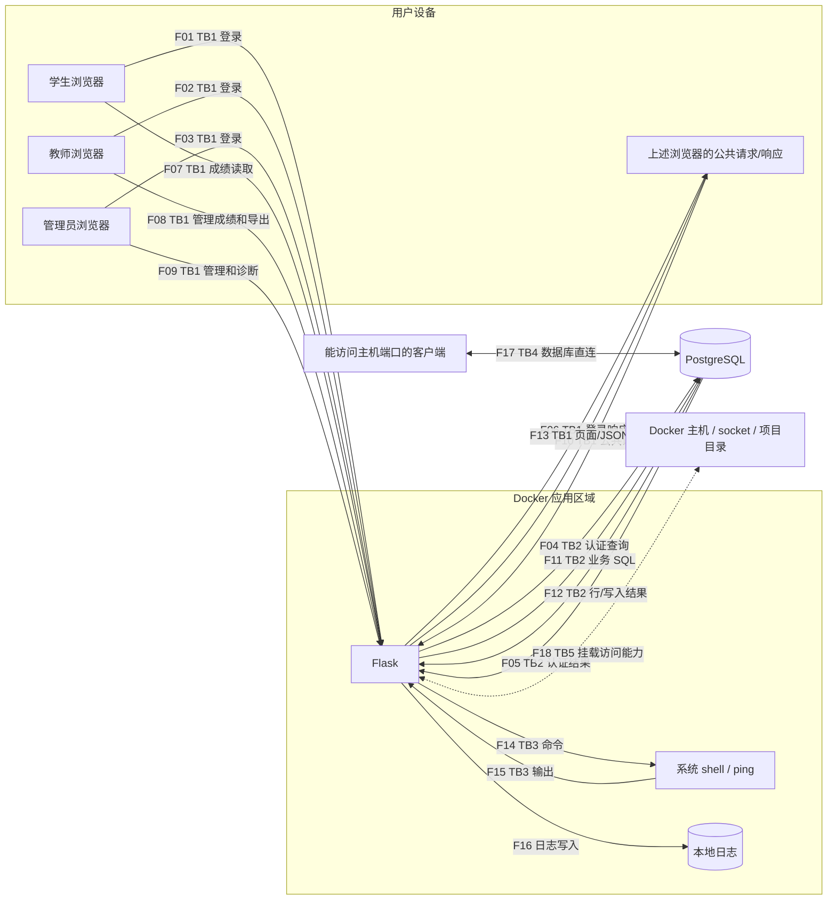
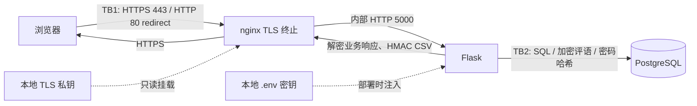

# Project 1 — NotesApp threat model and risk analysis

作者：汪芮。分析日期：2026-10-22。个人完成记录，不虚构组员或课堂展示。
依据 Session 02 第 33–34 页与 Session 03 第 31 页。
基线为 fork 提交 `1c83e42` 的原始应用；本次课程修复后的变化单独列出。
本报告基于源码检查、正常账户访问与隔离实验，**不是已成功利用全部漏洞的证明**。

## 1. 资产与角色

| 资产 | 需要保护的性质 |
|---|---|
| 成绩、教师评语、学生与课程关联 | 保密性、完整性 |
| 密码、会话 Cookie、JWT 与角色 | 身份真实性、权限边界 |
| 数据库、应用与 Docker 主机 | 可用性、最小权限 |
| 导出文件和操作日志 | 完整性、可追溯性 |
| AES/HMAC 密钥、TLS 私钥 | 保密性、可恢复性 |

学生应仅能读取自己的成绩；教师应仅能管理自己的课程；管理员管理用户与课程。
实际代码的管理员页面仅列出课程，没有课程增删改路由，不能把课件角色描述误当已实现功能。
外部输入不可信，持有有效账户也不意味着有权访问每条记录。

## 2. 编号数据流图（原始基线）

**TB1**：用户设备与应用服务之间的身份/网络边界。
**TB2**：应用进程与数据库服务之间的凭据、SQL 与权限边界。
**TB3**：应用数据成为 shell 指令的解释边界；并不暗示 shell 已采用独立 OS 账户。
**TB4**：Docker 服务经主机发布端口暴露给外部客户端的边界。
**TB5**：容器与 Docker 主机权限边界。
F16 是同容器内的持久化数据流，文件权限形成访问控制边界，未画成独立网络边界。
F17 为一个双向数据库协议交换；F18 为配置提供的潜在通道，**未在实验中调用 Docker socket**。

## 3. 数据流清单与源码证据

| 编号 | 谁发送 → 谁接收；跨越的数据 | 代码位置（函数名，避免行号漂移） |
|---|---|---|
| F01 | 学生 → Flask；POST /login，username/password | `web/app.py:login` |
| F02 | 教师 → Flask；同一登录表单 | `login` |
| F03 | 管理员 → Flask；同一登录表单 | `login` |
| F04 | Flask → DB；拼接用户名/原始基线密码的 SELECT | `login` |
| F05 | DB → Flask；用户 ID、用户名、角色；新版本还读取 password 哈希 | `login` |
| F06 | Flask → 浏览器；登录 HTML、错误或 302 与签名会话 Cookie；JWT 存在会话内 | `login`、`make_jwt` |
| F07 | 学生 → Flask；GET /dashboard、GET /api/notes/id，Cookie 或 Bearer JWT | `dashboard`、`api_notes` |
| F08 | 教师 → Flask；GET /teacher、GET /export.csv?class_id=…、POST /grades 的 ID/成绩/评语 | `teacher`、`export_csv`、`grades` |
| F09 | 管理员 → Flask；GET /admin、POST /admin/users 的用户字段、POST /admin/ping 的 host | `admin`、`admin_users`、`admin_ping` |
| F10 | 浏览器 → Flask；GET /、/login、/logout、/healthz、/static/style.css | `index`、`logout`、`healthz`、Flask static |
| F11 | Flask → DB；成绩/课程/用户查询，成绩与用户增删改，健康连接检查 | `get_db` 与各业务函数 |
| F12 | DB → Flask；成绩、评语、课程、用户列表、执行结果或异常 | 同 F11 |
| F13 | Flask → 浏览器；页面、角色徽标、明文业务 JSON/CSV、错误和跳转；dashboard JS 内的 JWT | 模板、`api_notes`、`export_csv` |
| F14 | Flask → shell/ping；由 host 拼接的命令，ping 可进一步向指定主机发 ICMP | `admin_ping` |
| F15 | shell/ping → Flask；标准输出、错误或超时信息，随后经 F13 返回 | `admin_ping` |
| F16 | Flask → 日志文件；登录、成绩操作、诊断记录 | `log`、`web/Dockerfile` |
| F17 | 网络客户端 ↔ DB；原始 compose 发布的 5432、数据库认证和 SQL | `docker-compose.yml:db.ports` |
| F18 | Flask 容器 ↔ 主机；Docker socket API 和项目文件访问能力 | `docker-compose.yml:web.volumes` |

## 4. 初始 STRIDE 表（每个编号检查六类）

S=冒充，T=篡改，R=抵赖，I=泄露，D=拒绝服务，E=提权。
下表描述可能的威胁；“无直接动作”表示该流本身不执行该类敏感操作，并非整个系统安全。

| 流 | S | T | R | I | D | E |
|---|---|---|---|---|---|---|
| F01 | 猜测/窃取学生密码 | 修改登录字段 | 登录归因不足 | HTTP 泄露密码 | 无速率限制耗资源 | 通过后续弱令牌越权 |
| F02 | 冒充教师 | 修改登录字段 | 教师否认登录 | 密码/会话在途泄露 | 重复认证占资源 | 获得教师写权限 |
| F03 | 冒充管理员 | 修改登录字段 | 管理操作归因不足 | 管理凭据泄露 | 重复认证 | 获得管理权限 |
| F04 | 共用 DB 凭据身份过宽 | 拼接 SQL 改变查询语义 | 缺少独立 DB 审计 | 异常泄露 SQL 细节 | 高成本/异常查询 | 查询越出认证目的 |
| F05 | DB 被替换/入侵返回假身份 | 角色结果被改 | 结果无独立溯源 | 身份字段泄露 | DB 不返回导致等待 | 接受恶意角色 |
| F06 | 弱会话密钥支持假身份 | HTTP 响应可被中途修改 | 登录日志可改 | Cookie/JWT 在途泄露 | 响应阻断 | 伪造角色会话 |
| F07 | API 接受无签名 JWT | 更改记录 ID | 缺少逐条读取审计 | API 不校验成绩所有权 | 无分页/限速请求 | 普通用户越过记录权限 |
| F08 | 被盗教师会话 | 任意记录 ID 写入、缺 CSRF | 日志缺少旧/新值 | 全班级读取和导出 | 大导出/大评语耗资源 | 未检查教师课程归属 |
| F09 | 被盗管理员会话 | 管理表单缺 CSRF | 用户增删无业务日志 | 用户与课程数据泄露 | 反复诊断/管理请求 | host 进入 shell 命令 |
| F10 | 假站点诱导登录 | 在途 CSS/页面修改 | logout/health 无独立审计 | health 直接返回 DB 错误 | health 反复建立连接 | 公共流无直接授权写入 |
| F11 | 共享 DB 身份缺少区分 | 数据库角色可写过多数据 | 缺少业务级 DB 审计 | 查询范围过宽 | DB 连接/锁耗尽 | 无记录/课程范围限制 |
| F12 | 入侵 DB 返回虚假结果 | 篡改成绩/评语 | 结果无历史签名 | 明文成绩/评语被读 | 大结果集耗内存 | 恶意评语经页面成为脚本 |
| F13 | 假响应/假导出冒充服务器 | 原始 CSV 无认证；评语不转义 | 原始导出无法证明来源 | 显示他人成绩、JWT 暴露给 JS | 大结果集耗浏览器资源 | 存储型 XSS 借用登录用户权限 |
| F14 | 通过被盗管理身份执行 | host 拼接进入 shell | 诊断记录不足以证明完整命令效果 | 命令读取文件/秘密 | 子进程与网络请求耗尽 | root 容器内执行任意命令 |
| F15 | 被控制子进程返回假输出 | 输出内容被伪造 | 无可信结果签名 | 命令输出泄露敏感信息 | 大输出占内存 | 输出本身为转义文本，无直接执行动作 |
| F16 | 日志可伪造事件主体 | 文件权限允许改写 | 可删改且缺少完整变更值 | 用户名/诊断信息外泄 | 无轮转填满磁盘 | 日志本身不直接授予权限 |
| F17 | 已知 DB 凭据冒充 DB 用户 | 绕过应用直接改库 | 无应用操作记录 | 直接读取密码与评语 | SQL/连接资源耗尽 | 数据库初始化账户权限过大 |
| F18 | 容器冒充受信主机客户端 | 修改挂载的项目/控制容器 | 主机操作未归因业务用户 | 主机文件/其他容器数据可泄露 | 控制或停止其他容器 | Docker socket 跨越容器隔离 |

## 5. 风险评分

这是对**原始应用按默认 compose 暴露**的定性排序，不是攻击频率统计。
L（可能性）：1=需要较强前提，2=需要账户/可达网络等条件，3=门槛低。
I（影响）：1=局部轻微，2=一个账户或部分业务，3=批量敏感数据/关键写权限/主机。
R=L×I；1–2 低、3–4 中、6–9 高。同分优先处理攻击链入口与影响范围。

| ID | STRIDE / 流 | 具体威胁 | L | I | R | 修复建议 |
|---|---|---|---:|---:|---:|---|
| R01 | T/E，F04 | 登录拼接 SQL 改变查询 | 3 | 3 | 9 | 参数化 SQL，数据库最小权限 |
| R02 | S/E，F06–07 | 无签名 JWT / 弱签名秘密导致身份伪造 | 3 | 3 | 9 | 固定允许算法、验证签名/时间、强随机密钥 |
| R03 | I/E，F07–08、F11–13 | API/教师读写未校验资源归属 | 3 | 3 | 9 | 每次访问检查学生或教师与课程/记录的关系 |
| R04 | I/S，F01–06 | HTTP 窃取密码和会话 | 2 | 3 | 6 | HTTPS、证书验证、关闭绕行端口 |
| R05 | I，F12、F17 | 失窃数据库直接暴露密码/评语 | 2 | 3 | 6 | 密码 Argon2id、评语 AES-GCM，密钥与备份分开 |
| R06 | T/E，F12–13 | 评语存储型 XSS | 2 | 3 | 6 | 保持模板转义，明确富文本白名单 |
| R07 | T/E，F14、F18 | 管理命令注入结合主机 socket | 2 | 3 | 6 | 避免 shell、校验参数、移除 socket、非 root |
| R08 | T，F08–09 | CSRF 触发成绩或用户更改 | 2 | 3 | 6 | CSRF token、Origin 校验、合理 Cookie 策略 |
| R09 | R，F16 | 篡改/缺失日志使变更无法追溯 | 2 | 2 | 4 | 受保护审计日志，记录操作者/目标/前后值 |
| R10 | D，F01、F10–11、F16 | 认证、DB、导出或日志耗尽资源 | 2 | 2 | 4 | 限速、限大小、超时、分页、轮转 |
| R11 | T/R，F13 | 接收方无法验证 CSV 是否被改 | 2 | 2 | 4 | HMAC 与可信校验工具；需公开验证时用签名 |
| R12 | I/T/E，F17 | DB 发布端口和已知教学凭据被滥用 | 2 | 3 | 6 | 不发布 DB、限制网络/账号权限并更换凭据 |

### Top 3：优先修复与验收

1. **R01 SQL 注入**：参数化用户名查询；验收是把特殊字符当字面值处理且合法登录正常。
   本次 Class 5 明确要求留到之后的课程，因此只记录，没有提前修复。
2. **R02 身份伪造**：拒绝 `alg:none`，严格验证算法、签名与有效期；验收是未签名、过期、错误签名令牌均拒绝。
   此项未修复，实验未伪造令牌。
3. **R03 资源越权**：对 API、教师列表、更新和导出统一做记录/课程归属检查；验收是不同角色/课程间隔离且正常访问不变。
   此项未修复，实验未以学生身份探测他人的成绩记录。

## 6. 本次课程修改后的边界与剩余风险

| 控制 | 结果 | 限制 |
|---|---|---|
| 评论 AES-GCM | 60 条种子评语加密，AAD 绑定记录 ID，篡改被拒绝 | 成绩/姓名未加密；运行中应用仍可解密 |
| 导出 HMAC | 完整文件校验通过、改动校验失败 | 文件内容仍明文；不防有效旧文件重放 |
| HTTPS | TLS 抓包无明文测试密码，8080 不再发布 | 自签证书需要明确本地信任；内部 HTTP 依赖隔离 |
| Argon2id | alice 登录迁移、错误密码不迁移、新用户直接哈希 | 未登录旧用户仍为明文；弱密码仍可猜测 |
| lab 覆盖配置 | DB 不发布、无主机/socket 挂载、nginx 仅环回 | 仅在加载 lab 覆盖文件时生效；原始基线配置保留供教学 |

密钥文件不得进 Git；应用环境、主机访问与密钥备份成为额外要保护的资产。
新措施没有解决 R01–R03 等课程后续问题，不能将此仓库描述为已适合生产。

## 7. 三分钟讲解提纲

- 0:00–0:40：系统角色与成绩、评语、凭据三类资产；说明实际管理员课程功能的限制。
- 0:40–1:20：展示编号数据流与 TB1/TB2，补充 shell、DB 直连、主机挂载边界。
- 1:20–2:15：解释 STRIDE 和 L×I，突出 SQL 注入、令牌伪造、记录越权三个优先风险。
- 2:15–3:00：展示加密/HMAC/HTTPS/Argon2 的实测结果，指出未修复风险和自签证书的限制。

这是可使用的讲解提纲，未声称已经完成课堂展示。
