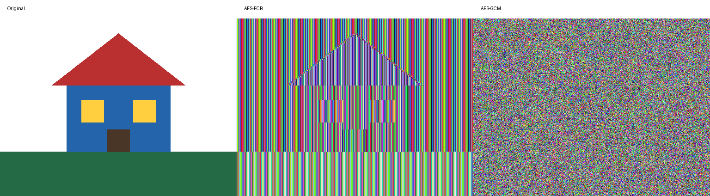

# Session 03 — symmetric encryption

依据课件第 30 页，完成课堂 Part 1、Part 2。所有输入均为本地生成的教学数据。

```sh
python3 -m venv .venv
.venv/bin/pip install -r labs/session03/requirements.txt
.venv/bin/python labs/session03/caesar.py
.venv/bin/python labs/session03/task2.py --run
```

- 凯撒：保留大小写、空格和标点；根据英语字母频率对 26 个候选位移做卡方评分。排名仅是统计推断，短文本和非英语文本可能误判，不声称总能破解。
- 图片：对原始 RGB 像素加密，而非 PNG 的压缩数据。ECB 使用 PKCS7 填充；GCM 使用 256 位随机密钥与 12 字节随机 nonce。
- 完整密文留在内存用于还原验证。输出图片只是截取密文像素后的可视化，不能用作可解密备份。密钥不会写入仓库。
- 同一 AES 密钥下，ECB 将重复明文块映射到重复密文块，保留图案；GCM 隐藏模式并通过认证标签拒绝篡改。



实际运行输出见 [results.txt](results.txt)。评论列加密为后续独立提交。
